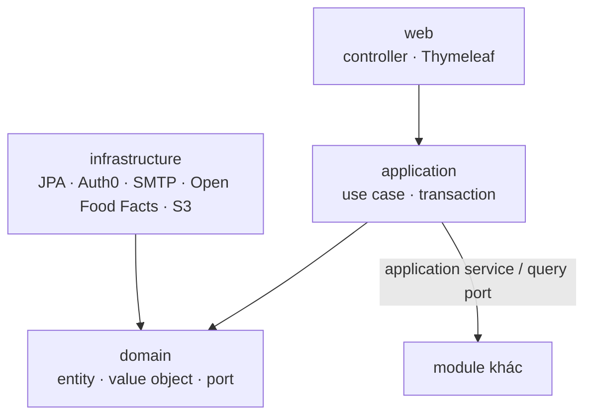
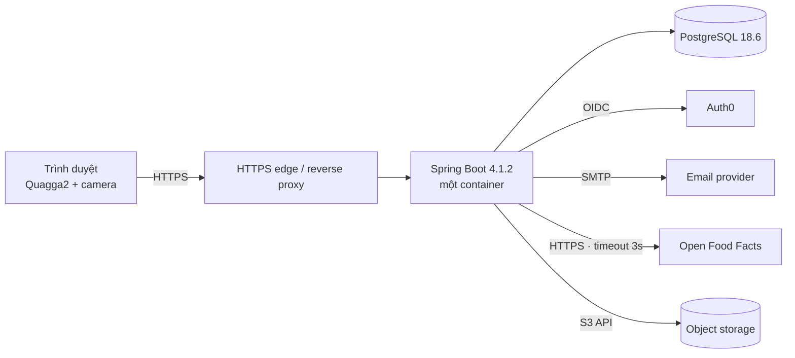
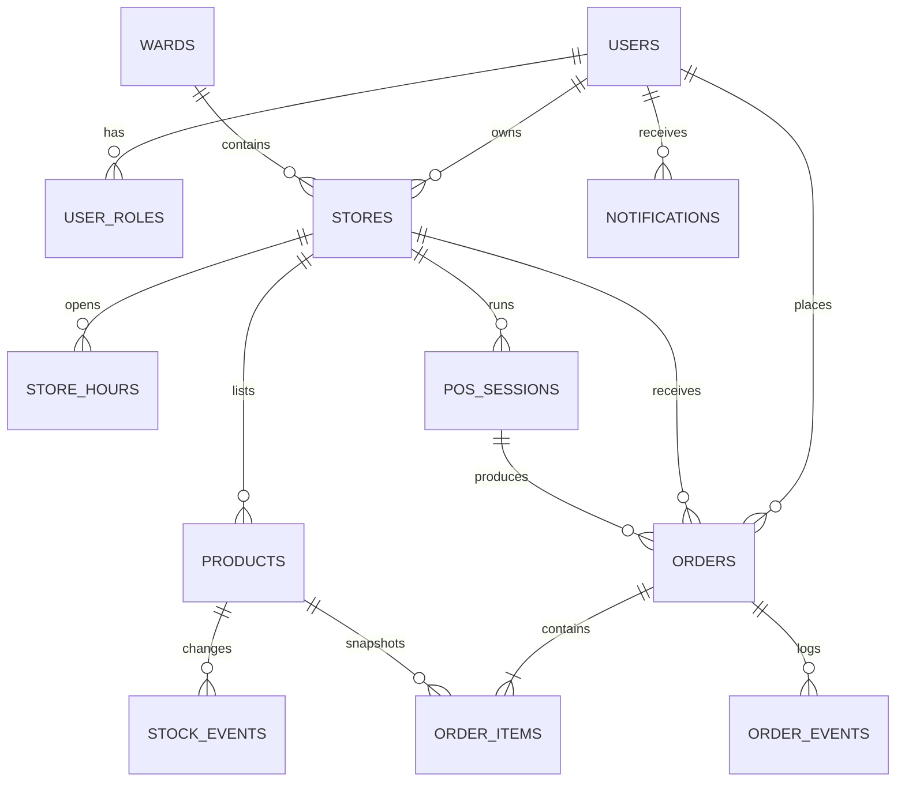

# Architecture Spine — Tạp Hóa Gần

## Design Paradigm

**Modular monolith, package-by-feature, layered trong từng module.** Một deployable duy nhất; module là biên sở hữu dữ liệu và là biên thay đổi. Mỗi module có bốn lớp: `web` (controller + Thymeleaf), `application` (use case + transaction), `domain` (entity, value object, port), `infrastructure` (JPA, Auth0, SMTP, Open Food Facts, object storage). `application` không phụ thuộc `infrastructure`; Spring DI nối adapter vào port.



Không có shared entity/repository package. `shared` chỉ chứa kiểu dùng chung: tiền, thời gian, khoảng cách, lỗi, bảo mật, ID.

## Invariants & Rules

### AD-1 — Modular monolith, package-by-feature

- **Binds:** all
- **Prevents:** một `entity/`, `repository/`, `service/` toàn cục biến thành big ball of mud; module này đọc/ghi trực tiếp repository của module khác.
- **Rule:** code nằm trong `vn.taphoagan.<module>.{web,application,domain,infrastructure}`. Module chỉ được phụ thuộc `shared`, `application` hoặc `domain` port của module khác; không phụ thuộc `infrastructure` hoặc repository của module khác. Không có vòng phụ thuộc giữa các module.

### AD-2 — Mỗi bảng có đúng một module sở hữu

- **Binds:** all
- **Prevents:** hai module cùng ghi một bảng; join chéo module làm schema không thể tiến hoá độc lập.
- **Rule:** mỗi bảng có một module ghi duy nhất. Module khác đọc qua query port hoặc read-only projection, không qua JPA association. `discovery` chỉ đọc `stores`/`products` qua `StoreCatalogQueryPort`; không ghi. FK trong cùng module được phép; tham chiếu chéo module bằng ID.

### AD-3 — Auth0 là danh tính, CSDL là phân quyền

- **Binds:** auth, store, ordering, pos
- **Prevents:** tin role trong token; IDOR khi mở đơn/cửa hàng của người khác.
- **Rule:** Auth0 chỉ xác thực OIDC. `user_roles` và `stores.owner_id` là nguồn sự thật. Lần đăng nhập đầu thêm `KHACH_HANG` vào `user_roles`; tạo cửa hàng thành công thêm `CHU_TIEM`. Mọi route `/store/**`, `/pos/**`, `/orders/**` kiểm tra cả vai trò và quyền sở hữu trong application service; truy cập object không thuộc sở hữu trả 404.

### AD-4 — Tiền, thời gian và bản chụp giá

- **Binds:** catalog, ordering, pos
- **Prevents:** sai số dấu phẩy động; lệch múi giờ; đổi giá hiện tại làm sai đơn cũ.
- **Rule:** tiền là `long` VND, DB `bigint`; cấm `double`/`float`. Thời gian là `Instant` UTC; hiển thị `Asia/Ho_Chi_Minh`. Mỗi dòng đơn lưu `name_snapshot`, `unit_price_snapshot`, `unit_snapshot`; đơn lưu `delivery_fee_snapshot` và `delivery_address_snapshot`; tổng đơn = tổng snapshot dòng + `delivery_fee_snapshot`; không tính lại từ giá hiện tại.

### AD-5 — Máy trạng thái đơn hàng

- **Binds:** ordering, pos
- **Prevents:** chuyển trạng thái không hợp lệ; hai lần chuyển đồng thời; mất audit.
- **Rule:** một enum `OrderStatus` với bảng chuyển hợp lệ. Chỉ `OrderApplicationService` đổi trạng thái; mỗi lần đổi ghi `order_events` trong cùng transaction. Dùng `@Version` optimistic lock. Tạo đơn dùng idempotency key. Controller/template không set trạng thái. Đơn tại quầy tạo trực tiếp `COMPLETED`, không đi qua máy trạng thái online.

### AD-6 — Một người ghi tồn kho

- **Binds:** catalog, ordering, pos
- **Prevents:** tồn kho âm; trừ hai lần; hai module có hai cách tính tồn.
- **Rule:** `StockService` là nơi duy nhất ghi `products.stock`. Giữ tồn khi đơn `CONFIRMED`; hoàn khi hủy; trừ khi POS hoàn tất; hoàn phần giảm khi xử lý thiếu hàng. Mọi thay đổi dùng một câu `UPDATE` có điều kiện (`SET stock = stock - :q WHERE id = :id AND stock >= :q`); 0 dòng nghĩa là không đủ tồn; không đọc-sửa-ghi. `stock >= 0`; mọi thay đổi ghi `stock_events`. Module khác không gọi repository của `products` để sửa tồn.

### AD-7 — Biên tra cứu mã vạch

- **Binds:** catalog
- **Prevents:** API ngoài chậm/lỗi chặn onboarding; gọi lặp cùng một mã.
- **Rule:** `BarcodeLookupPort` với timeout 3 giây; adapter Open Food Facts. Cache `barcode_cache` 30 ngày. Lỗi/timeout trả kết quả rỗng và UI chuyển sang nhập tay; không chặn lưu. Server chuẩn hoá mã (trim, uppercase) và kiểm tra hợp lệ; Quagga2 giải mã phía client, server không tin dữ liệu client.

### AD-8 — Truy vấn địa lý

- **Binds:** discovery, ordering
- **Prevents:** hai cách tính khoảng cách/bán kính khác nhau; lộ toạ độ khách.
- **Rule:** toạ độ `numeric(9,6)`. Một SQL function `distance_km(lat1, lng1, lat2, lng2)` là nguồn duy nhất cho mọi phép tính khoảng cách; `DiscoveryQuery` lọc bounding box rồi gọi function, `StoreQueryPort.distanceKm` cũng gọi function. Không có Haversine thứ hai trong Java. Hiển thị làm tròn 100 m. Không gửi toạ độ chính xác của khách cho cửa hàng. Không dùng PostGIS trong v1.

### AD-9 — Baseline bảo mật

- **Binds:** all
- **Prevents:** CSRF, XSS, IDOR, upload độc hại, lộ secret.
- **Rule:** Spring Security OAuth2 Client (không dùng SDK Auth0/Okta). `permitAll` chỉ cho `/`, `/stores/**`, `/search`, `/css/**`, `/js/**`, `/img/**`; mọi route còn lại yêu cầu đăng nhập. CSRF bật cho mọi request thay đổi trạng thái; cookie `HttpOnly`, `Secure`, `SameSite=Lax`. Logout dùng RP-initiated logout của Auth0. Bean Validation cho mọi input. Upload chỉ JPEG/PNG/WebP ≤ 2 MB, kiểm tra magic bytes. Không lưu dữ liệu thẻ. Giới hạn tần suất ở edge cho login, lookup và tạo đơn.

### AD-10 — Side effect sau commit

- **Binds:** ordering, notification
- **Prevents:** gửi email cho đơn đã rollback; giữ transaction mở trong lúc gọi SMTP.
- **Rule:** domain event phát trong transaction; listener dùng `@TransactionalEventListener(AFTER_COMMIT)` và executor có giới hạn. Lỗi email chỉ ghi log, không rollback đơn. Không gọi SMTP đồng bộ trong transaction. Không có outbox trong v1.

### AD-11 — Persistence và migration

- **Binds:** all
- **Prevents:** schema drift; auto-DDL xoá dữ liệu; migration sửa sau khi phát hành.
- **Rule:** Flyway là cách duy nhất thay đổi schema; `spring.jpa.hibernate.ddl-auto=validate`. Migration đã phát hành là bất biến; đổi bằng migration mới. Tên theo mẫu `V202611031200__catalog_create_products.sql` (thời điểm + module + hành động). PostgreSQL 18.6.

### AD-12 — Cấu hình và môi trường

- **Binds:** all
- **Prevents:** secret trong repo; profile local/pilot lệch nhau.
- **Rule:** ba profile `local`, `test`, `pilot`. Auth0, DB, SMTP, S3 đọc từ biến môi trường; không commit secret. `APP_BASE_URL` dùng cho callback/logout. Registration id là `auth0`, callback là `/login/oauth2/code/auth0`. `local` dùng Docker Compose; `pilot` dùng managed PostgreSQL và HTTPS edge. Managed PostgreSQL bật backup hằng ngày, giữ 14 ngày.

### AD-13 — Hợp đồng lỗi và quan sát

- **Binds:** all
- **Prevents:** mỗi màn hình một kiểu lỗi; log chứa PII/token; không truy vết được request.
- **Rule:** JSON lỗi dùng RFC 7807 `ProblemDetail` kèm `code`; HTML lỗi dùng các template `templates/error/404.html`, `500.html`, `403.html`. Domain exception map trong `@ControllerAdvice`. Log JSON có `requestId`, `userId` nội bộ, `orderCode`; không log token, email đầy đủ, số điện thoại hay toạ độ. Actuator health/metrics chỉ mở ở cổng nội bộ.

### AD-14 — Baseline kiểm thử

- **Binds:** all
- **Prevents:** H2 che lỗi PostgreSQL; state machine và tồn kho không được kiểm thử.
- **Rule:** JUnit 5 + MockMvc + Testcontainers PostgreSQL 18; không dùng H2. State machine và stock transitions có bảng test. Adapter barcode/geo có contract test. `mvn verify` là cổng duy nhất.

### AD-15 — Biên UI server-rendered

- **Binds:** web, templates
- **Prevents:** logic nghiệp vụ trong template; SPA drift; JS inline rải rác.
- **Rule:** Thymeleaf render phía server; một layout + fragment; template chỉ hiển thị, không tính nghiệp vụ. Form POST + CSRF. Chỉ một module `static/js/scanner.js` cho Quagga2; không inline script ngoài cấu hình. Bootstrap 5.3.8 và Quagga2 1.13.0 được self-host trong `static/`; không dùng CDN trong pilot. Brand layer theo `DESIGN.md`.

### AD-16 — Lưu ảnh mặt hàng

- **Binds:** catalog
- **Prevents:** ảnh mất khi redeploy container; path traversal; phụ thuộc ổ đĩa cục bộ.
- **Rule:** `ImageStoragePort`; adapter S3-compatible (R2/S3). Bucket private; DB lưu object key, không lưu URL công khai; trình duyệt nhận signed URL ngắn hạn khi đọc. Ảnh ≤ 2 MB, JPEG/PNG/WebP, kiểm tra magic bytes. Nếu chưa cấu hình object storage, tính năng ảnh bị tắt; không ghi ra đĩa cục bộ.

### AD-17 — Tạo đơn là một giao dịch khép kín

- **Binds:** ordering
- **Prevents:** đơn tạo với giá/phí/bán kính/trạng thái tiệm đã cũ; double submit tạo hai đơn; đơn thiếu snapshot.
- **Rule:** `OrderApplicationService.create` chạy trong một transaction: đọc lại store + product, kiểm tra store đang mở, bán kính, đơn tối thiểu và mặt hàng còn hàng; tính lại giá hiện tại; ghi snapshot dòng, `delivery_fee_snapshot`, `delivery_address_snapshot`; insert order + items + event. Unique `(customer_id, idempotency_key)`; vi phạm trả lại đơn đã tạo thay vì tạo mới. Bất kỳ check nào fail thì không tạo đơn và giữ giỏ.

### AD-18 — Phiên POS và đơn tại quầy

- **Binds:** pos
- **Prevents:** hai phiên mở cùng lúc; double-click tạo hai đơn tại quầy; dòng POS thiếu snapshot.
- **Rule:** partial unique index đảm bảo tối đa một `pos_sessions` trạng thái `OPEN` cho mỗi store. `completeSale` nhận idempotency key; vi phạm trả lại đơn đã hoàn tất. Đơn tại quầy là `Order` `type=POS`, tạo trực tiếp `COMPLETED`, ghi `order_events`; dòng POS lưu snapshot tên/giá/đơn vị; tồn kho đi qua `StockService`.

### AD-19 — Nhật ký sự kiện chỉ ghi thêm

- **Binds:** ordering, catalog, pos
- **Prevents:** audit bị sửa/xóa; sửa lịch sử thay vì ghi sự kiện mới.
- **Rule:** `order_events` và `stock_events` là append-only; không `UPDATE`/`DELETE`. DB user của ứng dụng chỉ có `INSERT`/`SELECT` trên hai bảng này. Mọi điều chỉnh là một sự kiện mới, không sửa sự kiện cũ.

### AD-20 — Giỏ hàng là session state

- **Binds:** ordering
- **Prevents:** hai mô hình giỏ (session và DB) làm mất giỏ khi đăng nhập; giỏ tồn tại vô hạn.
- **Rule:** giỏ là DTO trong HTTP session; không có bảng `carts` trong v1. Đăng nhập không xóa session, nên giỏ được giữ nguyên. Giỏ chỉ chứa mặt hàng của một cửa hàng. Session idle hết hạn sau 8 giờ. Checkout luôn đọc lại giá và trạng thái trước khi tạo đơn.

### AD-21 — Hết hạn đơn nhận tại tiệm

- **Binds:** ordering, notification
- **Prevents:** đơn `READY` quá hạn không được xử lý; hai instance cùng xử lý một đơn.
- **Rule:** một `@Scheduled` job chạy mỗi 5 phút, giữ `pg_try_advisory_lock` để chỉ một instance chạy. Job tìm đơn `READY` có `pickup_hold_until < now`, gọi `OrderApplicationService` chuyển `NO_SHOW`, hoàn tồn qua `StockService`, phát event thông báo. Job idempotent: đơn đã `NO_SHOW` không xử lý lại.

## Consistency Conventions

| Concern | Convention |
| --- | --- |
| Ngôn ngữ code | Class, package, bảng, cột dùng tiếng Anh; UI và microcopy tiếng Việt. Map: cửa hàng→`Store`, mặt hàng→`Product`, đơn hàng→`Order`, đơn tại quầy→`Order` với `type=POS`, tồn kho→`Stock`, chủ tiệm→`StoreOwner`. |
| Package | `vn.taphoagan.<module>.<web|application|domain|infrastructure>`; không có package `entity`, `repository`, `service` toàn cục. |
| ID | `bigint` identity PK nội bộ. Đơn có `code` công khai `TH-YYMMDD-XXXX` unique; cửa hàng có `slug` unique; `users.auth0_sub` unique. Không dùng UUID. |
| Tiền | `long` VND; DB `bigint`; format `25.000 ₫`; không dùng `BigDecimal` cho tiền mặt. |
| Thời gian | `Instant` UTC; hiển thị `Asia/Ho_Chi_Minh`; JSON ISO-8601. |
| Lỗi | `ProblemDetail` + `code` cho JSON; trang lỗi HTML cho trình duyệt; không lộ stack trace. |
| Trạng thái | Chỉ application service được đổi; entity không có setter công khai cho `status`. `order_events` và `stock_events` append-only. |
| Auth | Rule route ở `SecurityConfig`; kiểm tra sở hữu ở application service; không tin hidden field. Session in-memory, idle 8 giờ. Không mở CORS; mọi request cùng origin. |
| Log | JSON qua SLF4J; `requestId`, `userId`, `orderCode`; không PII. |
| Config | `application.yml` + profile; secret qua env; không `@Value` rải rác, dùng `@ConfigurationProperties`. |
| Template | `templates/<module>/...`; fragment dùng chung ở `templates/fragments`; không logic nghiệp vụ. |
| JS | `static/js/scanner.js`; không framework; Quagga2 1.13.0; không inline script. |
| API nội bộ | JSON chỉ dưới `/api/**` cho tác vụ async của trình duyệt; trả `ProblemDetail`; không public API v1. |

## Stack

| Name | Version |
| --- | --- |
| Java | 25 (LTS) |
| Spring Boot | 4.1.2 |
| Spring Framework | 7.0.10 (managed by Boot 4.1.2) |
| Spring Security | 7.1.x (managed by Boot 4.1.2) |
| Thymeleaf | 3.1.x (managed by Boot 4.1.2) |
| Thymeleaf Extras Spring Security | managed by Boot 4.1.2 |
| Bootstrap | 5.3.8 |
| Quagga2 | 1.13.0 |
| Leaflet | 1.9.4 |
| OpenStreetMap tiles | OSM standard (attribution) |
| PostgreSQL | 18.6 |
| Flyway | managed by Boot 4.1.2 |
| Hibernate ORM | managed by Boot 4.1.2 |
| Maven | 3.9.x |
| Auth0 | OIDC (không SDK) |
| Spring Mail | managed by Boot 4.1.2 |
| Testcontainers | managed by Boot 4.1.2 |
| Micrometer / Actuator | managed by Boot 4.1.2 |
| Docker Engine | 27+ |
| HTTPS edge | Managed reverse proxy / Caddy 2.8+ |

## Structural Seed

### Source tree

```text
src/main/java/vn/taphoagan/
  auth/            # OIDC login, user provisioning, role checks
  store/           # store profile, hours, service radius, status
  catalog/         # products, barcode lookup, images, stock writer
  discovery/       # nearby query, search read model
  ordering/        # cart, checkout, order state machine, order events
  pos/             # counter session, POS sale, receipt
  notification/    # in-app notifications, email after commit
  shared/          # money, time, geo, error, security, ids
src/main/resources/
  templates/       # layout, fragments, auth, discovery, store, catalog, cart, checkout, orders, pos, error
  static/          # css, js/scanner.js, img
  db/migration/    # Flyway
```

### Deployment



Một instance ứng dụng trong pilot. Session lưu trong bộ nhớ; chấp nhận mất session khi redeploy. Khi cần nhiều instance, chuyển sang Spring Session JDBC — nằm ở Deferred.

### Core entities



## Capability → Architecture Map

| Capability / Area | Lives in | Governed by |
| --- | --- | --- |
| Đăng nhập, vai trò, chuyển chế độ | `auth` | AD-3, AD-9 |
| Hồ sơ cửa hàng, giờ mở cửa, bán kính | `store` | AD-2, AD-8 |
| Danh mục, quét mã, tra cứu, ảnh | `catalog` | AD-2, AD-6, AD-7, AD-16 |
| Khám phá gần, tìm kiếm | `discovery` | AD-2, AD-8 |
| Giỏ, checkout, đơn, trạng thái | `ordering` | AD-4, AD-5, AD-10, AD-17, AD-19, AD-20, AD-21 |
| POS tại quầy, biên nhận | `pos` | AD-4, AD-5, AD-6, AD-18, AD-19 |
| Thông báo trong app và email | `notification` | AD-10, AD-13, AD-21 |
| Vận hành, cấu hình, log, test | `shared` + hạ tầng | AD-9, AD-11, AD-12, AD-13, AD-14, AD-15 |

## Deferred

- **Thanh toán điện tử:** chưa có trong v1; thêm cổng thanh toán là module mới, không sửa `ordering`.
- **Điều phối giao hàng:** cửa hàng tự giao; không có shipper service trong v1.
- **Nhiều cửa hàng mỗi chủ, tài khoản nhân viên:** schema đã có `stores.owner_id`; mở rộng sau khi có nhu cầu.
- **Bảng quản trị:** vận hành pilot thao tác trực tiếp; chưa có module admin.
- **Bản đồ, đánh giá, xếp hạng tìm kiếm:** bản đồ chỉ dùng để ghim vị trí cửa hàng khi onboarding; không dùng ở discovery. Đánh giá/xếp hạng ngoài phạm vi v1.
- **Redis/cache tầng ứng dụng:** chưa cần; cache barcode nằm trong PostgreSQL.
- **Outbox/retry bền vững cho email:** dùng after-commit + log trong v1.
- **Nhiều instance và Spring Session JDBC:** một instance trong pilot.
- **Rate limit ở edge hay app:** chọn khi biết nhà cung cấp edge.
- **Nhà cung cấp email, object storage, hosting:** chọn khi triển khai; port đã cố định.
- **Chi tiết cột schema, index, UI component:** code và UX sở hữu sau khi build.

## Assumptions

- `[GIẢ ĐỊNH]` Host pilot chạy được Java 25 LTS; nếu không, hạ xuống Java 21 mà không đổi AD nào.
- `[GIẢ ĐỊNH]` Có Auth0 tenant và Google connection; tenant được cấu hình thủ công trước pilot.
- `[GIẢ ĐỊNH]` Quagga2 đọc được EAN/UPC/Code-128 trên iPhone Safari và Android Chrome mục tiêu; spike trên thiết bị thật trước khi build.
- `[GIẢ ĐỊNH]` Có SMTP và object storage S3-compatible; nếu chưa có object storage, tính năng ảnh bị tắt, không chặn luồng quét.
- `[GIẢ ĐỊNH]` Pilot chạy một instance ứng dụng; khi cần nhiều instance, chuyển session sang Spring Session JDBC và rate limit sang edge.
